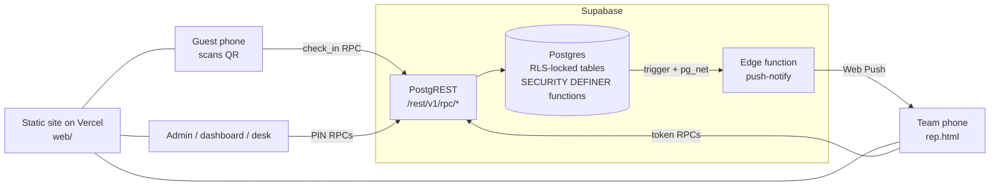

# event-checkin

**A QR-code check-in and live lead-tracking system for events — built to answer one question in real time: _who we invited vs. who actually showed up_.**

Guests scan a QR code at the door, type their name and mobile number, and they are checked in. The system matches the number against your invitation list, **pings the team member who invited them**, routes walk-ins to a team member (by name or by a weighted round-robin), and gives everyone a live dashboard. Afterwards every guest is a row in a follow-up pipeline.

It was built in a few days for a two-day real-estate expo (about 950 invitees, 16 relationship managers, ~215 check-ins) and run live on the day. This repository is that system, cleaned up so you can run your own event on it.

* **No app to install.** Guests, staff and observers all use their phone browser.
* **No server to run.** A static website + a Postgres database (Supabase). Free tiers are enough for a typical event.
* **No build step.** Plain HTML/CSS/JS — open a file, change it, deploy it.

> 📖 **New here?** Read [docs/STORY.md](docs/STORY.md) (why and how this was built), then [docs/DEPLOYMENT.md](docs/DEPLOYMENT.md) (go live in ~30 minutes).

---

## What it does

| Who | Page | What they can do |
|---|---|---|
| **Guest** | `index.html` (the QR code points here) | Check in with name + mobile, say who invited them or which team member they are in touch with, party size, tables they plan to visit, optional preference questions, consent to be contacted. Duplicate check-ins are caught. |
| **Team member** | `rep.html?t=<personal token>` | Gets a **push alert** the moment one of *their* guests arrives (even with the phone locked). Sees *Arrived / Yet to arrive / Walk-ins & requests / Done* tabs for each event day, taps **"I've got this guest"**, edits party size and tables, sets a **lead stage** (New → Hot/Warm/Followup → Converted/Lost), writes notes, calls or WhatsApps the guest in one tap, and marks themselves **Away** so the rotation skips them. |
| **Admin / organiser** | `admin.html` (PIN) | Upload the RSVP list (CSV/Excel/paste), edit event name, team, questions and tables, print the **QR code** (kiosk mode too), generate personal links for the team, add **observer** links, reset data. |
| **Live dashboard** | `dashboard.html` (PIN or observer link) | Invited vs actual, walk-ins, headcount, arrival timeline, team scoreboard, "guests waiting for a team member" banner, alert-readiness board, live feed with Done / Party / Reassign / Link / Merge, per-day tabs, CSV exports. Works full-screen on a big monitor. |
| **Front desk** | `desk.html` (PIN or observer link) | Search the list and check someone in manually, or add a walk-in by hand. |

### Highlights

* **Invited vs actual** — numbers are matched on the last 10 digits; second numbers can be linked to the same invitee; look-alike names are flagged so a guest who used a different number is not double-counted.
* **Real-time alerts** — standards-based Web Push (works on Android Chrome and iPhone iOS 16.4+ when added to the home screen). The database calls a small edge function through `pg_net`; no third-party push service account is needed.
* **Walk-in routing** — guests who name a team member go to them; guests who name nobody go through a **weighted round-robin** (e.g. 20/20/20/10/10/10/10), skipping anyone marked Away.
* **Multi-day events** — each day has its own check-in; guests are counted for the day they arrive. Dashboard and team pages have **date tabs** so yesterday's guests can be called back today.
* **Follow-up pipeline** — lead stage + note per guest, multi-select "table/project" tags, who handled whom, Done button, CSV export of everything.
* **Reporting** — [`tools/export_report.py`](tools/export_report.py) builds an Excel report with pivots, and [docs/ANALYTICS.md](docs/ANALYTICS.md) shows the statistical checks used after the real event.
* **Safe by default** — every table is locked by row-level security; the browser can only call a short list of functions, each gated by a PIN or an unguessable token. See [docs/SECURITY.md](docs/SECURITY.md).

---

## How it works (30-second version)



The website is just files. All logic lives in Postgres functions, so there is no application server to keep alive on event day. Read [docs/ARCHITECTURE.md](docs/ARCHITECTURE.md) for the data model and the reasoning behind each choice.

---

## Quick start

```bash
git clone https://github.com/Akshat-Gurnani/event-checkin && cd event-checkin
```

1. **Supabase**: create a project → SQL editor → run [`supabase/schema.sql`](supabase/schema.sql), then your edited copy of [`supabase/seed.sql`](supabase/seed.sql).
2. **Edge function** (for push alerts): deploy [`supabase/functions/push-notify`](supabase/functions/push-notify/index.ts) with *Verify JWT* **off**.
3. **Website**: put your project URL and publishable key in [`web/config.js`](web/config.js), then deploy the `web/` folder (Vercel: set *Root Directory* to `web`, framework *Other*).
4. Open `/admin.html`, enter your PIN, upload your guest list, print the QR.

Full walkthrough with screenshots-in-words and troubleshooting: **[docs/DEPLOYMENT.md](docs/DEPLOYMENT.md)**.
Run `scripts/smoke_test.sh` afterwards to verify the deployment and that anonymous users cannot read your tables.

---

## Repository map

```
web/                       the entire front end (static, no build)
  index.html  checkin.js     guest check-in form
  rep.html    rep.js         team member page (alerts, leads, notes)
  dashboard.html dashboard.js live dashboard + exports
  desk.html   desk.js        front-desk manual check-in
  admin.html  admin.js       organiser console (RSVP upload, QR, links)
  common.js style.css sw.js  shared client, theme, service worker (push)
  config.js                  <- your Supabase URL + key + time zone
supabase/
  schema.sql                 tables, RLS, 58 functions, triggers, grants
  seed.sql                   first-run settings (PIN, event config, team)
  functions/push-notify/     edge function that sends the Web Push
tools/export_report.py       Excel report with pivots from the live data
scripts/smoke_test.sh        deployment health + security check
docs/                        story, architecture, deployment, customisation,
                             operating guide, security, RPC reference, analytics
```

## Adapting it to your event

Weddings, conferences, trade shows, open houses, college fests, product launches… The vocabulary ("builder tables", "team member") is configurable and the schema is generic. See **[docs/CUSTOMIZATION.md](docs/CUSTOMIZATION.md)** for what to change and how.

## Documentation

| Doc | Read it to… |
|---|---|
| [STORY.md](docs/STORY.md) | understand why this exists, how it was built in days, and what went wrong and right |
| [ARCHITECTURE.md](docs/ARCHITECTURE.md) | see the data model, auth model, alert pipeline and design trade-offs |
| [DEPLOYMENT.md](docs/DEPLOYMENT.md) | deploy your own copy step by step |
| [CUSTOMIZATION.md](docs/CUSTOMIZATION.md) | rebrand, relabel, change time zone, adapt to another kind of event |
| [OPERATING_GUIDE.md](docs/OPERATING_GUIDE.md) | run the event: before, during, after (a runbook) |
| [SECURITY.md](docs/SECURITY.md) | know what is public, what is protected, and what to do about personal data |
| [RPC_REFERENCE.md](docs/RPC_REFERENCE.md) | look up every database function the front end calls |
| [ANALYTICS.md](docs/ANALYTICS.md) | turn the data into pivots and honest conclusions |

## Status and honesty

This was built for one event and hardened while real guests were walking in, not designed as a product. It is small, readable and it worked. Known limitations (shared admin PIN, tokens in URLs, no per-user audit log, English-only UI) are listed in [docs/SECURITY.md](docs/SECURITY.md#known-limitations). Issues and pull requests are welcome.

## License

MIT — see [LICENSE](LICENSE). Keep your guests' data private and respect local data-protection law when you collect it.
