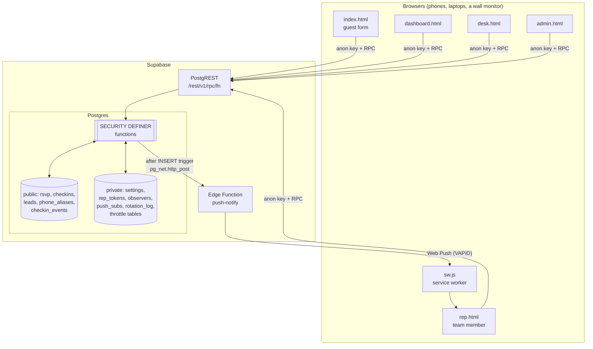
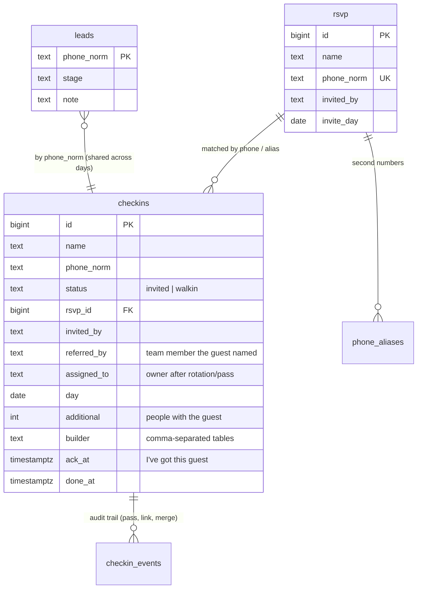

# Architecture

## 1. Big picture



There are three pieces:

1. **`web/`** — static files. No server-side rendering, no bundler. Each page is one HTML file plus one JS file, plus `common.js` (RPC client, helpers, modals) and `style.css`.
2. **A Postgres database** exposed only through **RPCs** (`/rest/v1/rpc/<function>`). The tables are not reachable from the browser at all.
3. **One edge function** (`push-notify`) that signs and sends Web Push messages. It is called only by the database.

## 2. Why "everything is an RPC"

Supabase exposes tables over REST by default and relies on row-level-security policies. For this app a policy-per-role-per-table model would have been large and easy to get wrong. Instead:

* Row-level security is **enabled** on every public table and **no policy is created**, and all table privileges are revoked from `anon`/`authenticated` → the REST table endpoints return nothing.
* The browser calls **`SECURITY DEFINER`** functions. They run with the owner's rights, so they can read and write tables the caller cannot touch, and each one begins by **checking a credential** (PIN or token) and returning `{"error":"unauthorized"}` otherwise.
* `search_path` is pinned to `''` in every function and all references are schema-qualified — the standard defence against search-path hijacking in definer functions.

This keeps all authorisation logic in one language, next to the data, and makes the API surface auditable: `supabase/schema.sql` ends with the list of exactly which functions `anon` may execute.

## 3. Data model



Key design points:

* **`phone_norm`** is the last 10 digits of whatever was typed. It is the identity of a person. `rsvp.phone_norm` is unique; `checkins` is unique on `(phone_norm, day)` and on `(rsvp_id, day)`, so a person can check in once per day but on several days.
* **`status`** is decided by the database at check-in time (`invited` if the number or an alias matches the RSVP list, else `walkin`). The browser cannot choose it.
* **`invited_by` / `referred_by` / `assigned_to`** are three *different* facts and all are kept: who invited the guest (RSVP), which team member the guest said they were in touch with, and who currently owns the guest after rotation or a hand-over. The "owner" shown in the UI is computed from them (assigned > invited by > named by).
* **`leads`** (stage + note) is keyed by phone, not by check-in, so a guest's pipeline status follows them across days.
* **`builder`** holds one or more table names, comma-joined and canonicalised against the configured list by `private.canon_builder()`. (It started as a single value; multi-select was added without a migration by keeping the column type and teaching the canonicaliser to accept lists.)
* **`checkin_events`** records hand-overs, links and merges, so nothing is silently rewritten.
* **`private.*`** tables are in a schema that is never exposed through the API: settings (config, PIN hash, push secret, VAPID keys), per-rep tokens, observer tokens, push subscriptions, the rotation log, and throttle counters.

## 4. Authentication model

| Credential | Held by | Grants | Stored as |
|---|---|---|---|
| **Admin PIN** | the organiser | everything | bcrypt hash (`pgcrypto crypt`) in `private.settings` |
| **Observer token** `obs_<36 hex>` in the link | senior staff you add | dashboard, exports, front desk, and the dashboard's edit buttons (Done, Party, Reassign, Builder tables). *Not* delete, merge, import, settings, stages/notes. | `private.observers` |
| **Rep token** (36 hex) in the link | each team member | only *their own* guests: acknowledge, done, party size, tables, stage, notes, availability, push subscription | `private.rep_tokens` |
| **Nothing** | guests | `get_event_config`, `check_in` | — |

Brute force: `is_admin()` counts failures per client IP (taken from `cf-connecting-ip`, which Cloudflare — Supabase's edge — sets and the client cannot spoof) and globally, and refuses after 20/300 failures in 15 minutes. `check_in` has a similar per-IP rate limit.

## 5. The check-in algorithm (`private.do_check_in`)

1. Normalise the phone (last 10 digits); reject anything shorter. Trim/clean the name; clamp party size to 0–20; canonicalise table names against the config.
2. Rate-limit by IP.
3. Look the number up in `rsvp`, then in `phone_aliases`. A hit → `status = invited`, copy `invited_by`.
4. If this person (by number or RSVP id) already has a check-in **today**, return `duplicate` (and raise the stored party size / tables if the new submission has more) without creating a row or notifying anybody.
5. If the guest named a team member, that person is the notified owner. Else, if invited, the inviter. Else (a true walk-in naming nobody) pick an owner by **weighted rotation** (below).
6. Insert the row. An `AFTER INSERT` trigger (`notify_checkin`) fires `pg_net.http_post` to the edge function **only if** at least one of the relevant team members has a registered device.
7. A `BEFORE INSERT` trigger (`flag_similar`) uses `pg_trgm` to flag look-alike names: a walk-in whose name resembles an unmatched invitee, or a check-in that resembles another check-in. The dashboard shows these as one-click *Same person · link* / *Merge* suggestions; nothing is merged automatically.

### Weighted rotation (`private.pick_random_walkin_owner`)

Settings hold `walkin_weights`, e.g. `{"asha":20,"bilal":20,"chitra":10}`. For each pick, among team members who are *in rotation* and *available*, choose the one with the **lowest `picks_today / weight`** (ties → higher weight → name). It is deterministic, never lets a heavy hitter run away, and converges to the exact shares. An advisory lock serialises concurrent picks so the shares stay exact under load. If everyone listed is Away it falls back to "whoever is least busy". Picks are recorded in `private.rotation_log`.

## 6. Day awareness

"Today" is `(now() at time zone 'Asia/Kolkata')::date` — change it for your venue (see [CUSTOMIZATION.md](CUSTOMIZATION.md)). `checkins.day` defaults to it. Dashboard and rep functions accept an optional `p_day`; the rep page uses `rep_dashboard` (today, used for alerts and availability) plus `rep_dashboard_day` (any day, used for the date tabs) so alert logic can never be affected by which tab someone is viewing.

An `rsvp.invite_day` (optional) lets a multi-day list say "this person was invited for Day 2"; the invited counts for a day then only include people invited that day, plus those untagged. If nobody is tagged for the day, nothing is filtered (a safety net for lists with no day column).

## 7. The alert pipeline

```
INSERT checkins → trigger notify_checkin → pg_net.http_post → push-notify edge function
   → rpc push_prepare(secret) → { messages: [{endpoint,keys,title,body,url}], vapid keys }
   → web-push sendNotification() → browser push service → sw.js 'push' event → notification
```

* The edge function has **no state and no secrets of its own**. It authenticates to the database with a random shared secret (`private.settings.push_secret`) and gets everything it needs from `push_prepare`.
* **VAPID keys** are generated by the edge function on first use (`push_store_keys`); the private key is stored in `private.settings` and never sent to a browser. The public key is served by `get_push_key()`.
* Each team member registers a device from their page (`rep_push_subscribe`). Subscriptions that the push service reports as gone (404/410) are deleted (`push_remove`).
* `sw.js` shows the notification with `requireInteraction` and vibration, and focuses (or opens) the team page when tapped.
* iPhone caveat: Web Push only works for sites **added to the Home Screen** on iOS/iPadOS 16.4+. The team page detects this and shows step-by-step instructions.

## 8. Front end

* **No framework.** Pages render with template strings and `innerHTML`; every dynamic value goes through `esc()` first. Each page polls its RPC every ~4 s while visible (cheap: one function call), and refreshes immediately when the tab becomes visible again.
* **`rpc()`** (in `common.js`) wraps `fetch` with a 12 s abort timeout, JSON handling and a friendly error.
* **Guarding re-renders.** A 4-second poll must not wipe what someone is typing, so pages skip a re-render while a `<textarea>`/`<select>`/checkbox inside the list has focus, and re-render when focus leaves.
* **Security headers** are set in `web/vercel.json` (CSP with `script-src 'self'` plus the two pinned CDN scripts under SRI, `X-Frame-Options: DENY`, `no-store` on private pages, `noindex`).
* **Theme** lives in CSS custom properties at the top of `style.css`.

## 9. Trade-offs, honestly

| Choice | Upside | Downside |
|---|---|---|
| Polling every 4 s instead of Realtime subscriptions | Trivially simple, works through any proxy, no connection state | Up to 4 s latency; steady load of ~1 request/4 s/open page (fine for dozens of pages) |
| Tokens in URLs | One tap to open; nothing to type on a phone | Anyone with the link has that access; links can leak via screenshots. Rotate tokens after the event (`admin_rotate_rep_token`) |
| Shared admin PIN | No account system to build | No per-person audit trail |
| `SECURITY DEFINER` RPCs instead of RLS policies | One place for authorisation logic; tiny API surface | Each new function must remember its credential check — review them like you'd review an auth middleware |
| Static site + Postgres only | Nothing to keep alive on event day | Business logic in SQL is less familiar to some teams |
| Comma-joined `builder` text | No migration to go multi-select mid-event | Not relational; counts need an `unnest` (done in `admin_dashboard`) |
